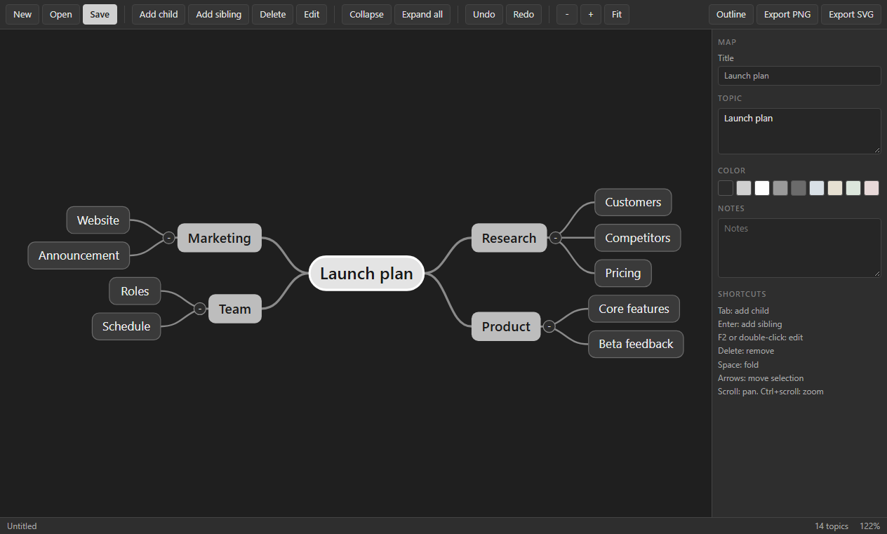

# Branchout

A calm, private mind-mapping app for Windows. Capture ideas, organize them as a branching map and export them, with no account, no subscription and no internet connection.

## What you can do

- **Build a map fast** with the keyboard: Tab adds a child, Enter adds a sibling, Space folds a branch
- **Branches grow on both sides** of the central topic and lay themselves out automatically
- **Topic colors**, notes on any topic, and a note marker so nothing gets lost
- Fold and unfold branches, move around with the arrow keys
- Pan, zoom, fit to window, undo and redo
- **Outline view**: turn the map into an indented text outline and save it
- **Export** as PNG or SVG with a white background, or save as a Branchout file to continue later

## Your files stay on your computer

Branchout has no account, no cloud and no tracking. Files are opened and saved only through the dialogs you use, and nothing is uploaded.

## Download

Get **Branchout-Setup-1.0.0.exe** from the [Releases](../../releases/latest) page and run it.

Part of the [Lookout](https://github.com/plawanpawin-byte/Lookout) family of apps.

Released under the MIT License.
