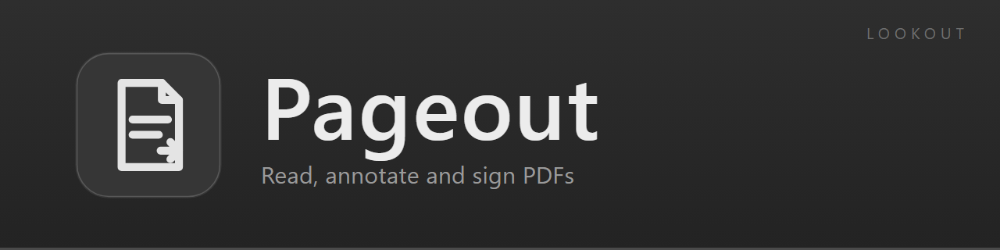
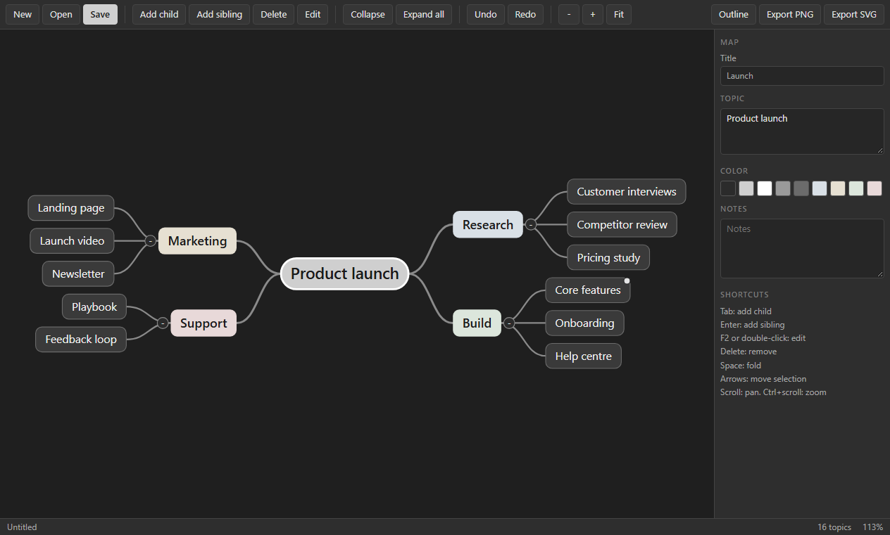
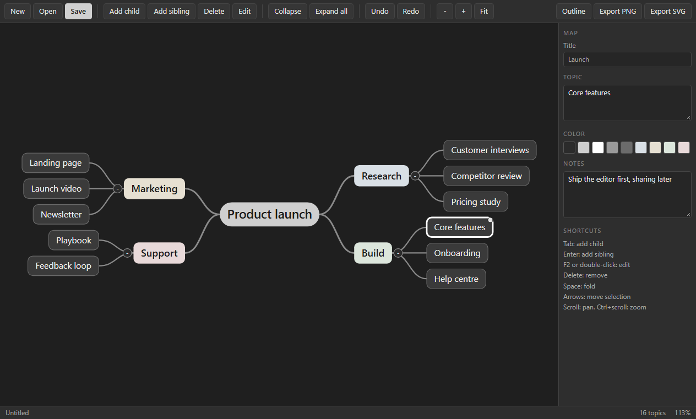
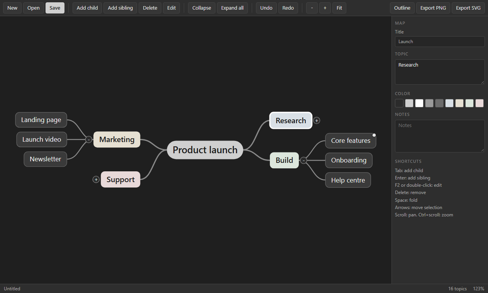
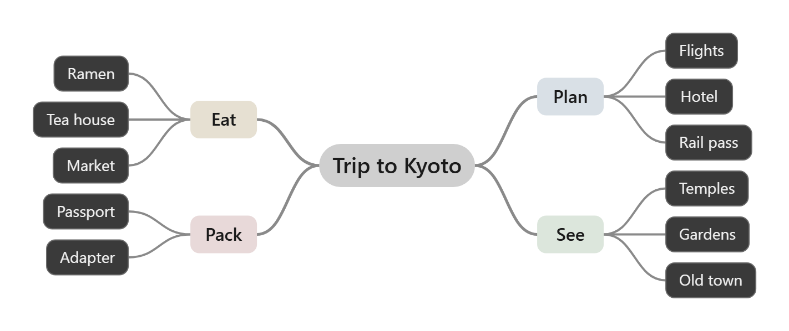

<b>Mind maps and outlines</b> Version 1.0.1 for Windows · Free · Offline · No account

<a href="https://github.com/plawanpawin-byte/branchout/releases/latest"><b>Download Branchout</b></a> · <a href="https://github.com/plawanpawin-byte/Lookout">All Lookout apps</a>

---

Branchout is a mind-mapping app. Start with one idea in the centre, branch out with topics and sub-topics, add notes and colour, collapse the parts you are not working on, and turn the whole map into an image or a text outline.

**Made for:** Planning a project, studying for an exam, preparing a talk or sorting out your own thoughts.

## See it in action

### A mind map

A central topic with four branches. The layout spreads to both sides automatically as you add topics.

### Topic details

The side panel edits the selected topic: rename it, pick a soft colour and write notes. A small dot marks topics that carry a note.

### Collapsed branches

Fold away branches you are not working on. A plus sign shows that something is hidden underneath.

### Exported PNG

The map exported as a high-resolution image, ready for a document or a slide.

### Outline output

The same ideas as an indented list you can paste into an email or a document.

## Everything it can do

### Building a map

- Add a child topic or a sibling with a single key
- Rename and delete topics
- Automatic, balanced layout on both sides of the centre
- Pan, zoom and Fit to see the whole map

### Detail

- Eight soft colours for topics
- Notes on any topic
- Collapse and expand any branch, or expand everything at once

### Keyboard first

- Tab adds a child, Enter adds a sibling, F2 edits, Delete removes, Space folds
- Arrow keys move the selection around the map

### Files and export

- Save and reopen .branchout files
- Export PNG or SVG
- Export the map as an indented text outline (Markdown)

## How to use it

1. Click **New** and type your central idea.
2. Press **Tab** to add a child topic and **Enter** to add a sibling.
3. Select a topic and choose a colour or write a note in the right-hand panel.
4. Press **Space** to fold a branch you want out of the way.
5. Open **Outline** for the text version, or **Export PNG** / **Export SVG** for an image.

## Keyboard shortcuts

| Keys | What it does |
| --- | --- |
| Tab | Add child topic |
| Enter | Add sibling topic |
| F2 / double-click | Edit text |
| Delete | Remove topic |
| Space | Fold or unfold |
| Arrow keys | Move the selection |
| Scroll / Ctrl + scroll | Pan / zoom |

## Files and formats

Saves .branchout files. Exports PNG, SVG and a Markdown or plain text outline.

## Private by design

- No account, no sign-in, no subscription, no ads.
- Branchout works offline. It never sends your files, your text or anything about how you use it anywhere.
- Files are opened and saved only through the Windows file dialogs you use. Branchout cannot browse your disk on its own.
- The app window runs in a locked-down sandbox with a strict content policy.

## Install

1. Open the [latest release](https://github.com/plawanpawin-byte/branchout/releases/latest) and download the file named **Branchout-Setup-** followed by the version number and **.exe**. You can also install it from the [Lookout launcher](https://github.com/${OWNER}/lookout-launcher), which keeps it up to date.
2. Run the installer. It installs just for you, so it does not ask for administrator rights.
3. Windows may show a blue **Windows protected your PC** screen because these installers are not signed with a paid certificate. Click **More info**, then **Run anyway**.
4. Open Branchout from the Start menu.

**Requirements:** Windows 10 or 11, 64-bit. About 500 MB of free disk space. No internet connection is needed to use the app.

## Questions

**How many topics can a map hold?**  
Hundreds are comfortable. The counter in the bottom bar shows how many you have.

**Can I import from another mind-map app?**  
Not yet. You can type or paste your topics in as you go.

## About Lookout

Branchout belongs to the **[Lookout](https://github.com/plawanpawin-byte/Lookout)** family: ten small, private Windows apps for documents and media, all with the same calm grey look and the same promise that your files stay yours. Install and update them together with the [Lookout launcher](https://github.com/plawanpawin-byte/lookout-launcher).

Released under the MIT License.
